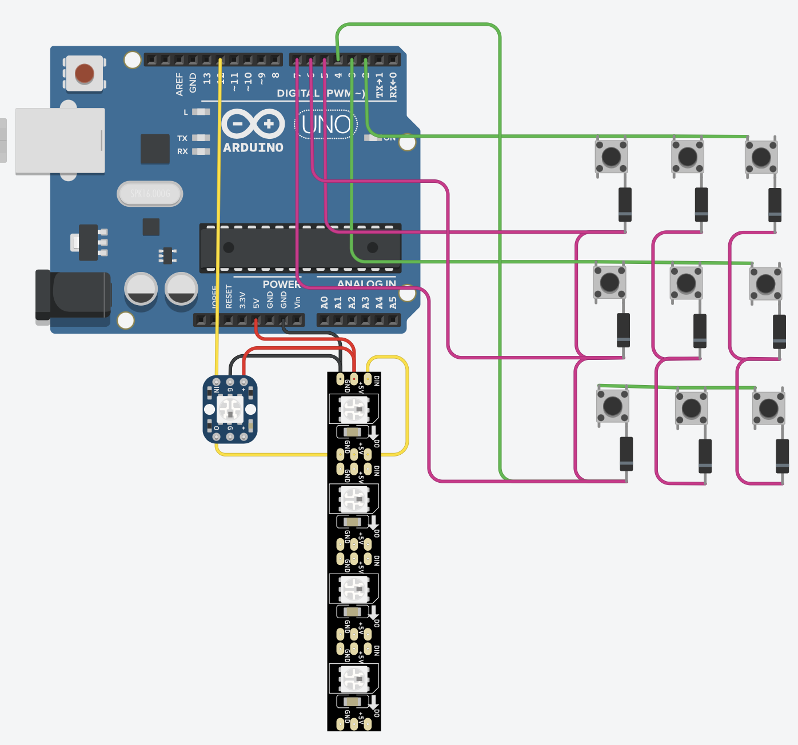

# smart_chess_board

## Product Functionality:

- A 33x33x4 cm cardstock chess board with extra features
- An RGB led under each square.
- When you pick up a piece, it shows you where you can place it by lighting up those squares green.
- Power by USB cable with type-C connector for the board. Any wall socket adapter or modern computer device (laptop, phone, etc) should work.
- Intricacies like how pins, checks and pawn promotions will be handled are not mentioned here but they will be handled.
- Modes: 2 player; and online mode.
- 2 player mode is basic over the board gameplay enhanced by LED move guiding.
- 'Online' mode allows you to connect the smart board to the Chessconnect extension on a device (laptop, phone, etc) using the same USB cable. (one end plugged into device and other into smart board)
- Chessconnect facilitates comminication between smart chess board and popular chess platforms, allowing the smart board to work with Chess.com, Lichess and other websites.
- In online mode, you can play against a bot or an online player on the chess platform.
- Online mode will show the possible moves for the lifted piece as usual, but it will also send your move to the chess platform so it moves on the on-screen board as well.
- When the oponent moves, there move is shown on the smart board by lighting those suares up. For example, if oponent moved peice from A1 to A4 then A1 and A4 will both light up blue on the smart board.
- This allows the user to move the piece physically for the oponent, allowing them to play the entire game on the physical smart board rather than on-screen.

## How it will work inside:

- An RP2040 based devboard controls the emedded system and the communication with the external device for online mode.
- 16 GPIO pins from the devboard connect to 16 strands of conductive thread.
- 8 of these strands will go under the chess squares in rows and 8 under columns; 8 of the GPIO pins will be output mode and 8 will be input pull-down.
- A matrix scanning system (like in a button matrix) will be used through these GPIO pins to detect presence of a chess peice on each sqaure.
- Diodes will be used at each square between the row and column threads to prevent "phantom" detections.
- Individually addressable LED strip will be layed under the squares in a snake pattern (1 LED per square), controlled by another GPIO pin.
- Each peice will be traced by the microcontroller --> so it always knows where each peice is --> so it knows what piece is picked up and where that peice can be placed --> so it can light the LEDs in the corresponding squares.
- WS2812B signalled by 3.3V logic is unreliable so "sacrificial pixel trick".
- Sacrificial pixel trick uses diode in series to lower voltage to first LED to drop 0.7V. Shown in circuit diagram below.

## Bridge to Chessconnect (references)

- A Millenium chessboard is spoofed to allow chess board to communicate with Chessconnect.
- This spoofing/using protocol is legal as of my knowledge gained from quick Google AI searches.
- The communication protocol was described in a [Github repository](github.com/domschl/python-mchess) by 'domschl' in [magic-board.md](https://github.com/domschl/python-mchess/blob/master/mchess/magic-board.md)
- The [coms.py](./chessconnect_(basic_firmware_tested)/coms.py) code in this repository is also copied from domschl's repository.
- The [main.py](./chessconnect_(basic_firmware_tested)/main.py) file is made partially by Google's Gemini AI using domschl's magic-board.md

## A [video](https://youtu.be/qUJj72wvn6k) that explains details ommited in this README though the prototype I have built.

## Prototype of smart chess board

- 4x4 grid instead of 8x8.
- Electronics represented by card.
- Conductive thread represented by string

## Circuit diagram

- Used Tinkercad to make it.
- Only 3x3 button matrix is shown but actual product will by 8x8.
- Only 4 LED pixels are shown but actual product will have a lot more (upto 90)
- Buttons simulate and represent the conductive thread connection brdge system.
- Arduino is used instead of RP2040 based devboard because Tinkercad doesnt have a Raspberry Pi Pico or anything similar.

## CAD

- [STEP file](./CAD.step)
- Used Onshape to make it: [link to document](https://cad.onshape.com/documents/bb6b214fba7b1a1f4080bd6d/w/d08a133f0f4a90c39aa4528d/e/1e47ae32b98daa02183d261b?renderMode=0&uiState=6ae1c935f8b1b6b820e7c9a6)

## Why I made this project + reflection

My freind tried to make a smart chess board for his IGCSE DT coursework but it turned out much harder than expected so he ended up changing his product to make it feasible. Back when he was making it, I said I can write the code for him because I was interested. Slowly I started helping him with hardware issues and choices because I was very interested. After he changed his idea, all the research I had done and everything I had learned stayed with me. Then the next year I did my own DT coursework and learned a lot about hardware as I built sunrise alarm clock. Then I did the Solder YSWS with Hackclub and learned a lot more about electronics and the overall design process. After that I was really busy with school work and finally during the summer holiday was the perfect time. I had a lot of time, a lot of experience and knowledge (not nearly enough to build this though yet), and excitment to finaly make this product. On the design process I learned a lot as expected and I think this is the most creative project I have built. I am proud of how creative and effective my idea to use conductive thread for matrix scanning was because it drastically simplified the classic reed switch or hall effect sensor method. I also don't like the idea of using expensive components and complex solutions to make a "quality" product so I made it a challenge to not just "make" the chess board, but also design in such a way that a biginner can easily build using minimal technical equipment. On the surface, the product may seem simple but that is because a lot of showerthoughts, dayfreaming and conversing with Google AI allowed it to be. Overall I find it very cool that I have designed a smart chess board built with card and metal string that will still work well and not look like just a scrappy prototype.